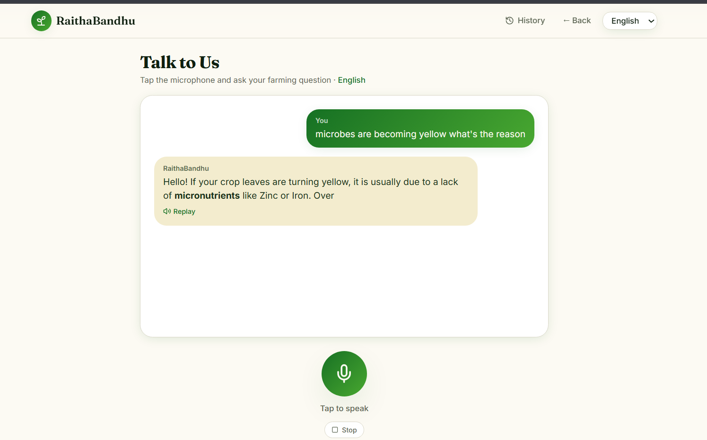
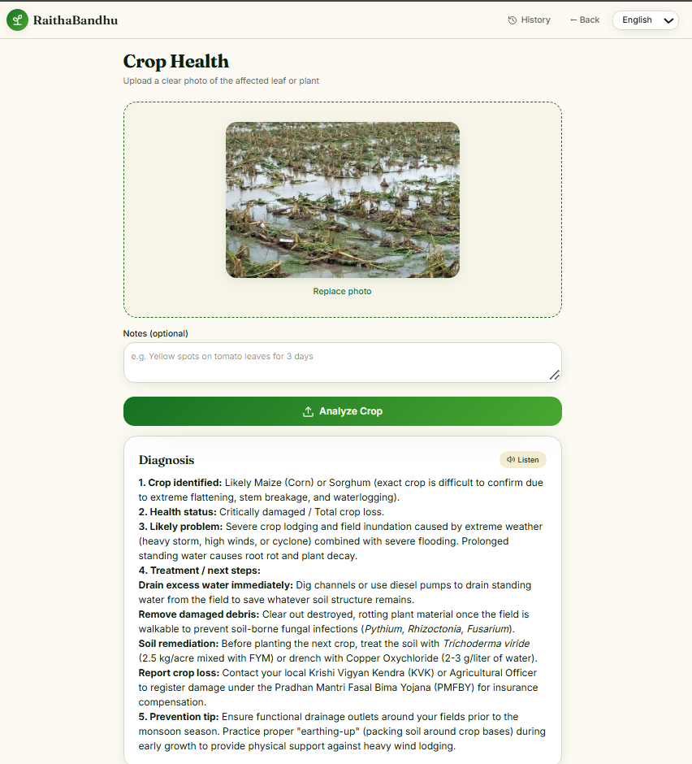
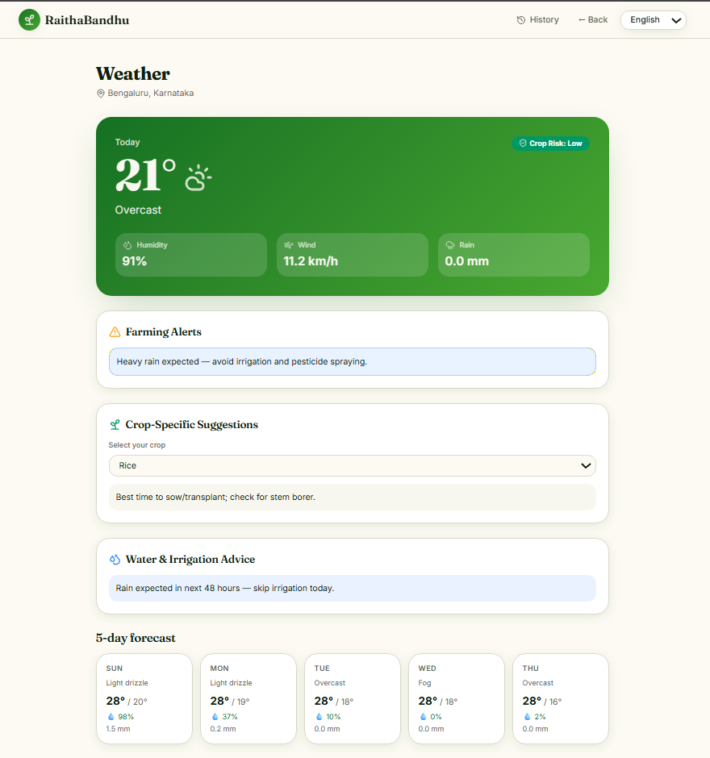
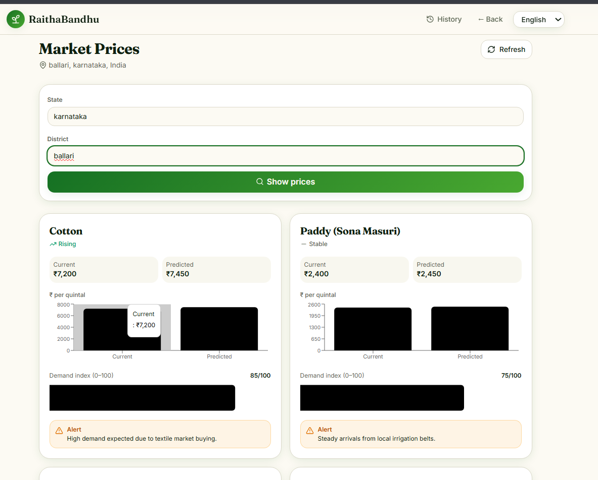
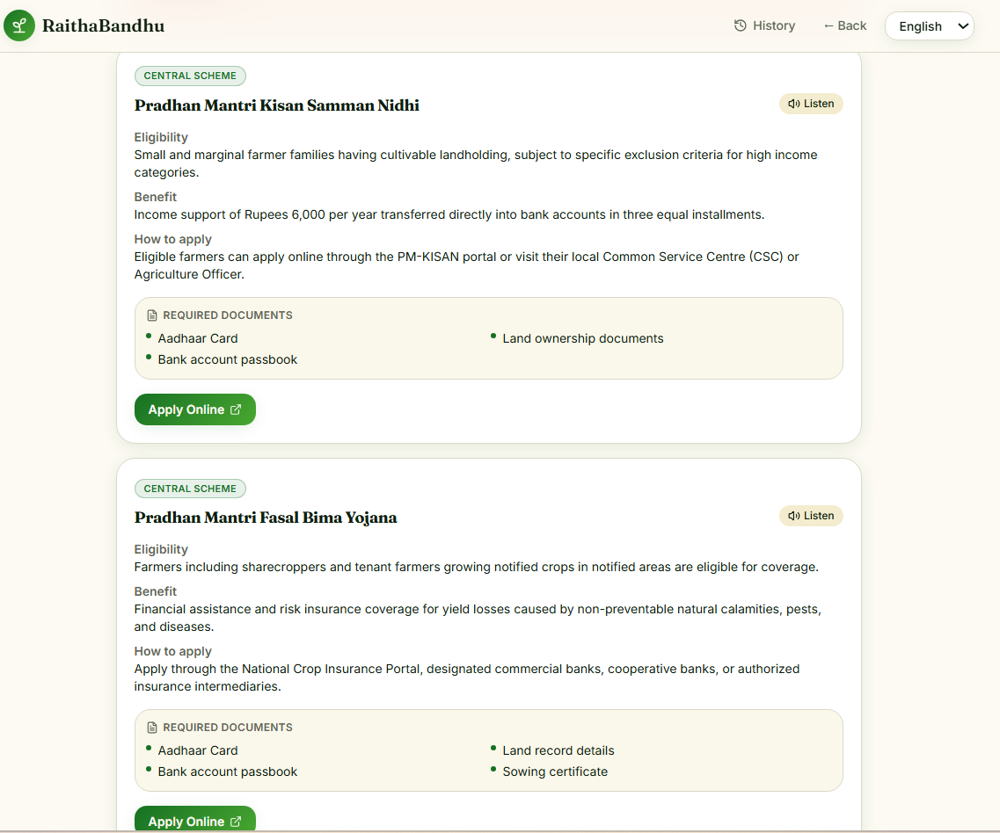
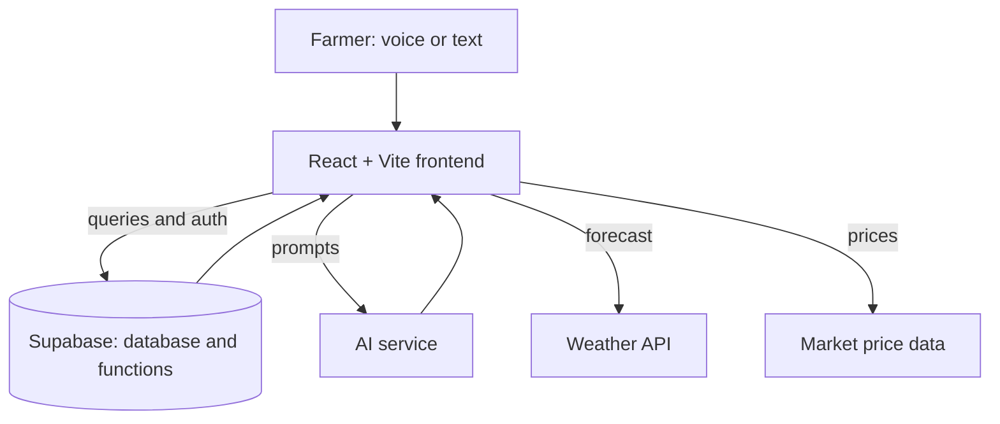
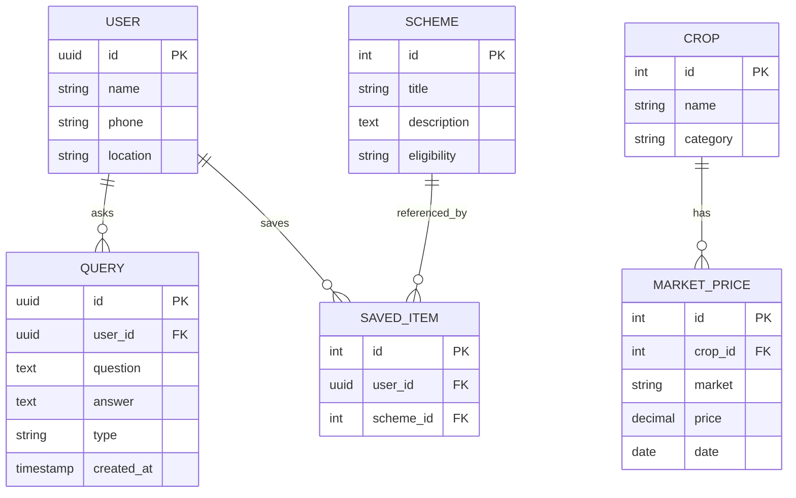

# 🌾 RaithaBandhu AI Farm Assistant

An AI-powered farming assistant that helps farmers get crop guidance, weather updates, market prices and government scheme information through **voice and text** interaction.




## Table of Contents

- [Overview](#overview)
- [Features](#features)
- [Screenshots](#screenshots)
- [Tech Stack](#tech-stack)
- [System Requirements](#system-requirements)
- [Getting Started](#getting-started)
- [Environment Variables](#environment-variables)
- [User Flow](#user-flow)
- [Architecture](#architecture)
- [Database Design](#database-design)
- [Project Structure](#project-structure)
- [Team](#team)
- [Limitations and Future Work](#limitations-and-future-work)

## Overview

Agriculture is central to the Indian economy, yet many farmers struggle to get timely information about crops, weather, prices and schemes. RaithaBandhu brings these into one interactive platform where a farmer can ask questions naturally, by speaking or typing, and get useful answers.

## Features

| Module | What it does |
|---|---|
| 🎙️ **Voice assistant** | Farmers describe a problem by voice or text and get AI guidance |
| 🌱 **Crop health** | Identify crop problems and get care suggestions |
| ⛅ **Weather** | Local forecast to plan sowing, irrigation and harvest |
| 💰 **Market prices** | Current crop prices to help decide when and where to sell |
| 🏛️ **Government schemes** | Information on schemes farmers can apply for |
| 📱 **Responsive UI** | Works on phones, tablets and desktops |

*(Edit this table so it lists only what the app really does.)*

## Screenshots

| Voice assistant | Crop health |
|---|---|
|  |  |

| Weather | Market prices |
|---|---|
|  |  |

| Government schemes |
|---|
|  |

## Tech Stack

| Layer | Technology | Purpose |
|---|---|---|
| Frontend | React, TypeScript **(verify)** | Component-based UI |
| Build tool | Vite | Fast dev server and bundling |
| Styling | Tailwind CSS, shadcn/ui **(verify)** | Responsive design and UI components |
| Backend / DB | Supabase | Database, authentication, storage and functions |
| AI | (name your AI API, e.g. Gemini or OpenAI) | Answers farmer questions |
| Voice | (e.g. Web Speech API) **(verify)** | Speech input and output |
| Hosting | Cloudflare (`wrangler`) | Deployment |
| Package manager | Bun / npm | Dependency management |
| Code quality | ESLint, Prettier | Linting and formatting |

## System Requirements

| Component | Version | Purpose |
|---|---|---|
| Node.js | 18 or higher | Runtime for Vite |
| Bun or npm | Latest | Package manager |
| Supabase project | Free tier is enough | Backend |
| Git | Any | Version control |

## Getting Started

### 1. Clone and install

```
git clone https://github.com/tejaswini-n-cse/YOUR-REPO-NAME.git
cd YOUR-REPO-NAME
npm install
```

(Use `bun install` if you prefer Bun.)

### 2. Configure environment variables

Copy `.env.example` to `.env` and fill in your own values (see below).

### 3. Run

```
npm run dev
```

Open http://localhost:8080

### 4. Build for production

```
npm run build
```

## Environment Variables

Create a `.env` file in the project root. Use your own keys and never commit this file.

```
VITE_SUPABASE_URL=your-supabase-project-url
VITE_SUPABASE_ANON_KEY=your-supabase-anon-key
VITE_AI_API_KEY=your-ai-api-key
```

*(Match these names to the ones your code actually reads.)*

## User Flow

```
1. Open the app
2. Choose a module: voice assistant, crop health, weather, market prices or schemes
3. Speak or type the question
4. The app sends it to the AI service and backend
5. The answer appears on screen (and can be read aloud)
```

## Architecture



## Database Design

*(Replace this with your real tables. Look in `supabase/migrations` or the Supabase table editor, and adjust names and fields to match.)*



## Project Structure

```
RaithaBandhu/
├── src/             components, pages, hooks and utilities
├── supabase/        backend config and migrations
├── screenshots/     README images
├── components.json  shadcn/ui config
├── vite.config.ts   Vite config
├── wrangler.jsonc   Cloudflare deployment config
├── package.json
├── .env.example     environment variable template
└── README.md
```


## Limitations and Future Work

| Limitation | Planned improvement |
|---|---|
| English-first interface | Add Kannada, Hindi and Telugu |
| Needs an internet connection | Offline mode for key information |
| Basic AI responses | Crop disease detection from photos |
| No alerts | SMS or WhatsApp alerts for weather and prices |

## Author

**Tejaswini N**
GitHub: https://github.com/tejaswini-n-cse
